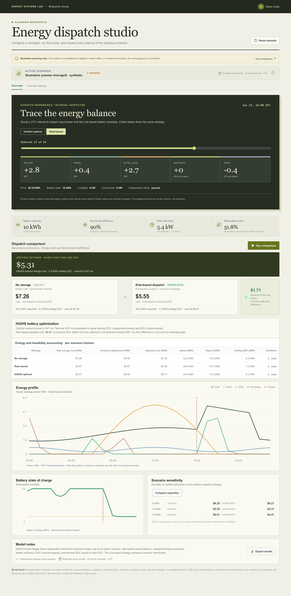

# GridOpt

[Frontend release audit](docs/frontend-audit.md) · [Product design brief](docs/design-brief.md)

GridOpt is an educational microgrid planning demonstrator. **Live demo:** [gridopt.vercel.app](https://gridopt.vercel.app/). It compares a no-storage baseline, a transparent heuristic, and a constrained battery optimizer using the same hourly or subhourly scenario. It does not control grid equipment, submit market offers, or provide engineering or investment recommendations.



[Mobile workflow screenshot](docs/screenshots/mobile.png)

## Run locally

Requirements: Node.js 22 or newer.

```sh
npm ci
npm run dev
```

Open http://localhost:5173. The seeded example works without an account, API key, or external service. For production-style local preview, run `npm run build && npm start` and open http://localhost:3000.

After running a comparison, use the workbench's strategy buttons to switch between the verified optimal and rule-based schedules. Scrub the interval slider or click the energy profile; both charts mark the inspected interval and follow the chosen strategy.

Copy `.env.example` to `.env` only if you want to set an EIA key or deployment values. The app never needs a key to run its synthetic example. `TRUST_PROXY_HOPS` defaults to `0`, so forwarded client addresses are ignored; set it to the exact number of trusted reverse-proxy hops only when deployment traffic cannot bypass those proxies. Do not commit `.env` or put API keys in source control.

## Architecture and model

- `src/` is a React/TypeScript responsive single-page dispatch workbench. Charts are accessible inline SVG with text labels and units. Scenario inputs remain in browser memory; there is no account, database, or data retention.
- `server/index.ts` serves `/api/health`, `/api/scenarios/demo`, `/api/run`, `/api/sensitivity`, and `/api/data/eia`, applies request limits and security headers, and serves the built client. Independently verified `/api/run` results have a 16-entry, five-minute process-local cache keyed by the validated scenario; the `X-GridOpt-Cache` response header reports `HIT` or `MISS`. Cold starts and changed scenarios still run the optimizer.
- `server/model.ts` validates the scenario and computes the baseline/heuristic; `server/optimizer.ts` builds and solves the bounded HiGHS mixed-integer model in a worker thread, keeping the API responsive. Results are checked against independently recomputed interval balance and SOC feasibility.
- GridOpt compares a deterministic rule-based heuristic with a genuine HiGHS mixed-integer linear program (MILP). The MILP chooses time-indexed charge/discharge, import/export, curtailment, and state-of-charge decisions; binary modes prevent simultaneous battery charge/discharge and grid import/export. It minimizes import cost net of export revenue under interval balance, efficiency, battery power/energy, reserve, and terminal-SOC-equals-initial constraints. HiGHS must report `Optimal` before the app labels a result optimal; other solver states are shown without a fabricated schedule. The known horizon is not a forecast.
- Solver and license: `highs` runs HiGHS locally as WebAssembly; HiGHS is MIT licensed. The existing rule-based dispatch remains as a benchmark.
- The initial SOC is set as a share of energy capacity and must meet the reserve. The optimizer constrains terminal SOC to equal initial SOC, so its raw energy objective needs no inventory adjustment. The heuristic allows a different ending SOC and is normalized to initial inventory at the final tariff as an illustrative accounting comparison. Its adjusted cost is not directly comparable as a proven optimality gap with the constrained optimum. The workbench shows ending SOC for all strategies and a negative baseline-minus-heuristic difference as a cost increase. That proxy ignores degradation and market settlement details.

### Units and constraints

| Quantity | Unit | Convention |
|---|---|---|
| Load, generation, charge/discharge, import/export, curtailment | kW | Average power over each interval |
| Battery capacity, SOC, imported/exported/curtailed energy | kWh | Energy; SOC updates with interval duration |
| Interval duration | hours | Derived from validated, evenly spaced timezone-aware timestamps |
| Buy price and export price | USD/kWh | User/demo tariff values; illustrative unless supplied by the user |
| Round-trip efficiency | fraction | Split symmetrically as square-root charge and discharge efficiencies |

For interval duration `dt`, SOC updates as `SOC[t+1] = SOC[t] + charge[t] * sqrt(RTE) * dt - discharge[t] / sqrt(RTE) * dt`. Charge/discharge power, SOC, reserve, and interval balance are checked. The heuristic does not charge and discharge simultaneously. The optimizer enforces exclusivity using binary variables and constrains terminal SOC to equal initial SOC, so its raw horizon objective requires no inventory adjustment. The heuristic is separately normalized to initial inventory at the final tariff for a fairer but illustrative comparison. Grid imports cover residual load, so unmet load is zero. With exports disabled, excess renewable power is curtailed; otherwise it is exported at the configured price. The MILP is an optimization under simplified perfect-foresight inputs, not a real-time dispatch recommendation.

The API accepts at most 168 intervals. Power capacities are nonnegative and bounded; input values must be finite. Battery energy and power capacity are separate fields and units.

## Data sources and provenance

### Synthetic example

The default 24-hour example is deterministic and generated in `server/index.ts`. Its name and source badge say **synthetic** in the dashboard and export. The profile is an illustrative summer day in UTC, with illustrative load, solar, wind, and time-of-use tariffs. It does not represent a particular place or customer.

### EIA hourly grid-demand profile

The optional integration queries the official [EIA API v2 hourly EIA-930 dataset](https://api.eia.gov/v2/electricity/rto/region-data/data/), selecting a balancing authority (MISO, PJM, NYIS, or CAISO) and the demand metric. EIA identifies the data as hourly demand, demand forecast, net generation, and interchange from Form EIA-930. The endpoint exposes UTC hourly and local-hourly frequencies; GridOpt requests UTC. EIA's returned demand is MWh in each hourly interval and its UTC `period` is the **hour-ending** timestamp. GridOpt subtracts one hour to label interval starts in the chart and exported scenario. The app uses the sequence only as a *shape*: it normalizes values to the example site's peak load, retains the observation timestamps, and explicitly labels the transformation. This is actual historical grid demand, not a site load or forecast. Importing it changes only the load shape; the current solar/wind profiles and tariff remain as configured, aligned by row index rather than observation time, and are explicitly labeled as noncontemporaneous illustrative inputs. Those combined profiles must not be interpreted as a measured site or weather record.

An EIA key is required for API requests. Register for a free key through [EIA Open Data](https://www.eia.gov/opendata/register.php); terms are on the registration page. Supply it in the password field for one request or configure `EIA_API_KEY` on the server. The key is not saved in browser storage, logs, or exports. Requests are limited to 24–168 hourly observations and time out. EIA data may be revised; the API identifies the source and observation times but this MVP does not archive a revision snapshot. If a request fails, the app reports the error and leaves the current source loaded. The user can explicitly retry or reset to the synthetic example.

### CSV input

CSV headers: `timestamp,load_kw,solar_kw,wind_kw,price_per_kwh`. Rows must contain nonblank, nonnegative numeric values and ISO timestamps with `Z` or an explicit UTC offset. Times must be ordered and evenly spaced. Imports are limited to 168 rows and 2 MB. This intentionally small CSV reader accepts plain comma-separated fields and does not implement quoted commas. CSV is parsed in the browser and only sent to the local API when the user runs the scenario. Results export as JSON (not spreadsheet formulas) and contain assumptions, units, data provenance, model version, objective, interval outputs, and the feasibility-check result.

## Scope and limits

This is not validated for real dispatch, market bidding, or investment decisions. It omits battery degradation, thermal/inverter constraints, reserve and ancillary markets, network congestion, interconnection, forecast uncertainty, taxes, demand charges, and operational safety. It does not model emissions. A user tariff is not an actual wholesale price or a customer-bill estimate. A storage-cost difference in one illustrative horizon is not a savings promise.

No real-time control loop, stored credentials, persistent user records, or paid service are included. No remote weather source is used because it is not needed for the synthetic planning example.

## Security and privacy

- API accepts at most 256 KB JSON bodies, 168 intervals per run, and 90 requests per IP per minute. Two expensive jobs may run concurrently; each solver call runs in a worker with an eight-second HiGHS limit and a 15-second worker timeout. Inputs are bounded and the dispatch is linear in horizon size. The in-memory limiter is per instance, which is sufficient for the single free service but not a distributed rate limit.
- Same-origin API only; no cross-origin access is enabled. Headers disable framing and content sniffing, restrict permissions and script sources, and conceal the Express signature.
- Errors returned to clients are scoped to validation/source issues. API keys and scenario data are not written to logs. No persistence is configured.
- CSV numeric columns, including blank values, and timestamps are validated before use. Export is JSON with safe download filename and no CSV/formula evaluation.
- Keep dependencies current and review `npm audit` output when updating them. CI installs exact lockfile dependencies.

## Checks and reproducible example

```sh
npm run lint
npm run typecheck
npm test
npm run build
npx playwright install chromium
npm run e2e
```

The unit fixture `server/model.test.ts` includes a one-hour, 2 kW import at $0.25/kWh, with expected energy charge **$0.50** and 2 kWh import. `server/optimizer.test.ts` checks an analytically simple charge/discharge schedule, terminal inventory restoration, exclusivity, zero capacity, and zero-load feasibility; API tests require an `Optimal` status and independently verified schedule. Numerical tolerances for independent interval balance and SOC recurrence are `1e-7` kW/kWh. Tests also cover charge/discharge efficiency, quarter-hour intervals, DST offset changes, zero generation/capacity, bounds, and invalid or uneven input. API tests cover health, demo-without-credentials, invalid requests, and missing EIA credentials. Browser smoke covers the example, settings edit, comparison, sensitivity on demand, zero load, CSV rejection, mobile layout, and result export. The browser suite uses dedicated port 3001 and refuses to reuse an unknown listener.

## Deploy

`vercel.json` deploys the Vite frontend to Vercel and forwards same-origin `/api/*` requests to the existing [Render backend](https://gridopt-u0xp.onrender.com/). Both the public page and API health endpoint returned HTTP 200, and the demo comparison produced an independently verified optimum through the Vercel URL on 2026-10-22. The Vercel project is connected to the GitHub repository. The API still depends on Render availability; its free instance may take about a minute to wake after inactivity. Vercel's [Hobby plan](https://vercel.com/docs/plans/hobby) has usage limits and is for personal, noncommercial projects.

`render.yaml` describes the deployed single free-tier Render web service. It sets `TRUST_PROXY_HOPS=1` for Render’s trusted load balancer; local runs default to zero and ignore untrusted forwarded headers. If Render’s proxy topology changes, verify client-IP handling before relying on per-IP limits. The service uses Node 22, runs `npm ci && npm run build`, starts with `npm start`, and checks `/api/health`. The public URL passed both health and demo optimization checks on 2026-10-22. EIA is optional; add a user-owned `EIA_API_KEY` in Render's environment settings to enable that integration. This Blueprint was connected using the public repository URL, so verify auto-deploy behavior before expecting later pushes to go live; manual sync in Render is available. Render's free web services spin down when idle and have included bandwidth/build limits; review the current [free service terms](https://render.com/docs/free) because usage beyond included amounts may incur charges.

## Acceptance checklist

The optional sensitivity view compares rule-based and MILP costs at 0.5×, 1×, and 1.5× battery energy and power after the user selects **Compare capacities**. It shows an optimized cost only when HiGHS reports an optimum and the independent verifier confirms balance, SOC dynamics, reserve/capacity, exclusivity, and terminal SOC.

- [x] Seeded synthetic example works without credentials.
- [x] Battery settings, renewable/load scaling, CSV input, and optional EIA demand-shape import.
- [x] Baseline, rule-based heuristic, and HiGHS MILP comparison with interpretable power/SOC charts and objective notes.
- [x] Independent energy balance, SOC, power, reserve, and capacity verification before display.
- [x] Sensitivity view, source attribution, units, and JSON export.
- [x] API, CI, tests, documentation, responsive styling, and deployment blueprint.
- [x] Public Render deployment: health endpoint and optimized demo scenario verified on 2026-10-22; EIA remains optional and unconfigured.
- [x] Public Vercel frontend: page, proxied API health, and verified optimization checked on 2026-10-22.
